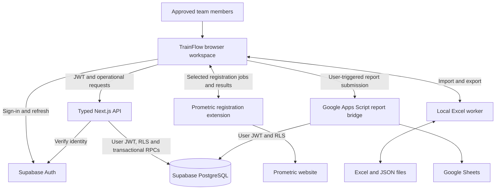
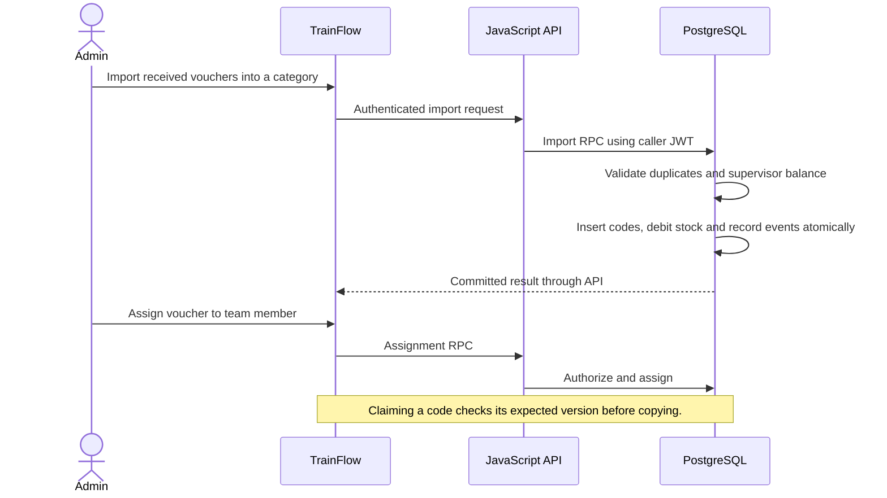

# TrainFlow architecture

TrainFlow manages the work between receiving exam vouchers, assigning them to a team member, preparing trainees, registering Prometric accounts and reporting results. This document describes the implemented system, rather than a proposed redesign.

Updated 7 October 2026 for the local migration. Production: [TrainFlow on Vercel](https://trainf.vercel.app/). Publication is a separate deployment step.

## System overview

The browser is the working surface. The server checks operational requests, while PostgreSQL policies and functions enforce ownership and atomic updates. Extensions execute only the external website actions that need a logged-in browser.

## Repository map

| Path | Responsibility |
| --- | --- |
| `app/`, `components/workspace/`, `lib/` | Next.js routes, maintained TSX screens and domain/engine interfaces |
| `codes-export.js` | Visible voucher-export dialog and colored XLSX preparation |
| `workspace.js`, `workspace.css` | Shared commands, Arabic/English strings and maintained styles |
| `client/cloud.ts` | Typed authentication, same-origin data adapter, codes, membership, backups and worksheet persistence |
| `client/navigation.ts` | Save-before-navigation and page/settings URL restoration |
| `ops-ui.js` | Administrative import, restore and settings interactions |
| `trainees.js`, `trainees.css` | Private trainee workspace and virtualized grid rendering |
| `trainees-core.js` | Trainee values, validation and matching logic |
| `trainees-excel.js` | Selection, formatting, formulas and spreadsheet commands |
| `trainees-xlsx.js`, `trainees-xlsx-worker.js`, `trainees-files.js` | Local Excel import/export and file previews |
| `certificate-name.js` | Certificate name correction preview and export |
| `prometric-core.js`, `prometric-registration.js` | Registration eligibility, job preview and extension coordination |
| `trainee-reports.js` | Daily report preparation and Google report submission |
| `session-policy.js` | Shared daily sign-in policy used by browser and API |
| `server/api.ts` | Typed API, caller JWT, membership validation, role/owner checks and bounded JSON writes |
| `extension/prometric/` | Manifest V3 registration extension and TrainFlow page bridge |
| `tools/build-site.cjs`, `tools/prepare-runtime.cjs`, `tools/workspace-source.cjs` | Compile typed assets, render maintained TSX for synthetic previews/static exports, hash assets and package extensions |
| `tools/design-preview.cjs` | UI preview with synthetic data; no production writes |
| `tools/google-reports.gs` | Google Apps Script bridge for existing report spreadsheets |
| `database.sql`, `migrations/`, `supabase/migrations/` | Original schema and incremental database changes |
| `tests/`, `database-tests.sql` | Unit, API, browser and SQL regression checks |
| `docs/` | Operations, deployment and integration documentation |
| `.github/workflows/ci.yml` | Automated unit checks and production build |
| `dist/` | Generated deployment output; ignored by Git |

## Data ownership

The existing database keeps its stable `ibta_*` object names. TrainFlow is the product name; these identifiers are a compatibility contract with deployed database functions and integrations.

| Table | Purpose and ownership |
| --- | --- |
| `ibta_members` | Approved accounts, active state and `admin`, `operator` or `copy_only` role |
| `ibta_settings` | Shared exam catalog, category labels, service connection details and configuration |
| `ibta_codes` | Unique vouchers, owner, usage timestamp, notes and optimistic version |
| `ibta_trainee_sheets` | Owner-specific trainee cells, formatting and save version |
| `ibta_supervisor_stock` | Unallocated supervisor stock per category |
| `ibta_supervisor_stock_events` | Stock adjustments and allocations |
| `ibta_audit` | Database-generated action, actor and timestamp records |

Auth accounts are managed separately from application backups.

## Main workflows

### Allocate and claim a voucher

Concurrent requests use server-side checks and optimistic versions. A clipboard failure retains the reservation for the same user, so they can retry or release it. Import, allocation and restore are database transactions.

### Edit a trainee sheet

The browser loads the signed-in account's private sheet and version; the page has no owner selector. Editing, sorting, formatting and Undo/Redo operate locally. Save submits cells and format with the expected version; a conflicting save is rejected. Virtual rendering draws the visible part of the sheet. Blank trailing rows do not expand the persisted matrix until populated.

### Register Prometric accounts

The application previews selected trainees, validates required values and skips existing credentials. The extension receives only selected names, emails and matching metadata, then processes registration jobs sequentially in a dedicated tab. Confirmed results fill blank matching credential cells. Pending results survive in extension storage until the application acknowledges a successful sheet save. Uncertain outcomes require checking Prometric before retrying.

### Copy an inventory report

The inventory page combines team balances, supervisor balances and category totals. Users can copy the report as text. There is no messaging integration or scheduled delivery.

### Exchange files and daily reports

Excel conversion uses a local Web Worker and bundled ExcelJS. JSON application backups use `trainflow-backup` and version 4; the restore path also accepts `ibta-ops-backup`. Google report submission uses the Apps Script bridge, reads authorized source data and appends matching report columns with voucher-based deduplication.

## API and trust boundaries

| Route | Behavior |
| --- | --- |
| `GET /api/health` | Public runtime status including the TrainFlow application name |
| `/api/data/<table>` | Allowlisted table operations with membership checks |
| `POST /api/data/rpc/<function>` | Allowlisted transactional operations; administrative functions require an administrator |

The worker rejects foreign origins, missing/invalid tokens, inactive memberships, disallowed routes, unsuitable methods and malformed/oversized JSON. It forwards the caller's JWT rather than using a service-role key. Operational responses use `Cache-Control: no-store`.

Supabase REST remains reachable by authenticated clients, including the report bridge. Database RLS remains necessary even with the worker. Display names in Auth metadata do not grant privileges. Extension bridges validate the page origin, message source and channel.

Only device preferences remain in browser local storage. Authentication uses session storage and daily sign-in rules. Registration results also have extension-local storage. Operational records are persisted in PostgreSQL.

## Interface and selection

React renders the TSX screens directly, without an iframe or raw HTML shell injection. Page links flush trainee drafts, update browser history and switch the mounted panel without downloading another document or booting the workspace again. Back/Forward restores panels, settings tabs and voucher categories. Failed saves retain the current screen and editable draft, including restoring its URL when history navigation is blocked. Direct links and refresh still load Next pages. The grid renders through typed React views with its existing spreadsheet command engine. The sidebar remains on the right, with full, 60 px compact and closed states. Its opener stays reachable; the account popup is portalled and clamped to the viewport.

Selections consist of an active rectangle plus additive rectangles. Coordinates refer to the displayed view; stored rows are resolved through its mapping. Drag/Shift extend adjacent cells or entire columns. Ctrl/Cmd adds or toggles separate areas. Union iteration visits overlaps once. Formatting, clearing and selected-row registration respect that union. Structural shifts, multi-cell paste and merges require one contiguous region so gaps are not changed accidentally.

Clipboard output contains both TSV and a styled HTML table. Separate rows/columns are compacted in displayed order and unselected intersections are blank. Stored colors and automatic result/duplicate-ID colors are copied; temporary selection overlays are excluded. Rich-paste support depends on the destination. Voucher export writes an XLSX workbook with the same usage-day palette and used-code strike-through. Standard category names remain English in both UI languages.

## Build and deployment

The build generates public/workspace, generated/workspace-assets.ts, compiled browser/API compatibility assets and .next. Maintained TSX is the screen source; generated asset metadata contains script addresses and the early language initializer. The Prometric ZIP is packaged from checked-in source. Operational records, SQL and private backups are not embedded in public assets.

~~~mermaid
flowchart LR
    Source[GitHub main] --> CI[Unit checks and build]
    Source --> Vercel[Vercel Next deployment]
    Vercel --> Build[pnpm build]
    Build --> Assets[Versioned workspace assets and extension ZIPs]
    Build --> Manifest[Generated TypeScript UI manifest]
    Build --> Next[Next production output]
    Manifest --> Next
    Assets --> Next
    Next --> Live[trainf.vercel.app]
~~~

All active integrations, browser extensions, and API routes are unified on the Vercel deployment. See [deployment](docs/deployment.md).

## Compatibility decisions

| Identifier | Reason it remains stable |
| --- | --- |
| Supabase project reference and API URL | Existing database and users stay attached to the same project |
| `ibta_*` tables/RPCs and SQL history | Existing schema, policies and deployed integrations depend on them |
| `IBTA_*` extension channels and internal error codes | Older extensions and server errors remain compatible |
| Existing storage keys | Saved preferences, pending jobs and extension state remain readable |
| `IBTAMEAF-…` voucher examples | Actual exam provider format, separate from product branding |
| `ibta-ops-backup` | Older backups remain restorable |

Rename these contracts only through a separately planned migration that updates all producers, consumers and stored data together.

## Verification and recovery

Run `pnpm test`, `pnpm test:browser` and `pnpm build` before publishing changes to runtime behavior. Browser suites require Microsoft Edge; SQL suites need a separately authenticated test database and are not part of JavaScript CI. A UI preview uses synthetic data and does not prove live sign-in or database writes.

For a faulty frontend deployment, roll back through Vercel or revert the Git commit and let the integration redeploy. Database migrations require their own recovery plan; a frontend rollback does not reverse schema changes. Application JSON exports supplement database backups and contain sensitive operational data, including configured credentials.

## Further reading

- [Operations guide](docs/operations-guide.md)
- [Deployment and maintenance](docs/deployment.md)
- [JavaScript API details](docs/javascript-server.md)
- [Google reports setup](docs/google-reports.md)
- [Documentation index](docs/README.md)

## Independent worksheets and voucher names — 6 October 2026

The trainee key is now (owner_id, sheet_id); the existing row keeps the fixed first-sheet identifier and its cells/format. Metadata includes sheet_name, sheet_order, sheet_hidden and tab_color. List/read queries scope the owner and selected sheet, and saves use ibta_save_trainee_worksheet with the existing optimistic version and validators. Legacy save RPCs target only the original worksheet. The worksheet action RPC serializes changes per owner, caps creation at 100 sheets and guards the last visible worksheet. RLS retains approved-owner access and the admin override. Audit keys now identify the worksheet, including deletions.

trainees-sheets.js manages tabs and metadata dialogs; trainees-borders.js stages border changes. trainees-core.js validates edge pens, row visibility, widths and non-destructive center-across metadata. Structural cell operations map values and styles together and reject overflow. Worker XLSX output includes formatting and borders. Cell Undo is isolated to the active worksheet; switching closes pending editors, saves first, increments the epoch and isolates Prometric session identity.

ibta_codes.trainee_name stores the voucher recipient. ibta_claim_trainee_voucher updates usage and name atomically under the existing owner RLS and version condition. Manual name edits require operator/admin membership and a current voucher version. Code replacement preserves the name; JSON restores and exports include it. The React VoucherName component renders the independent name input without reusing notes.
