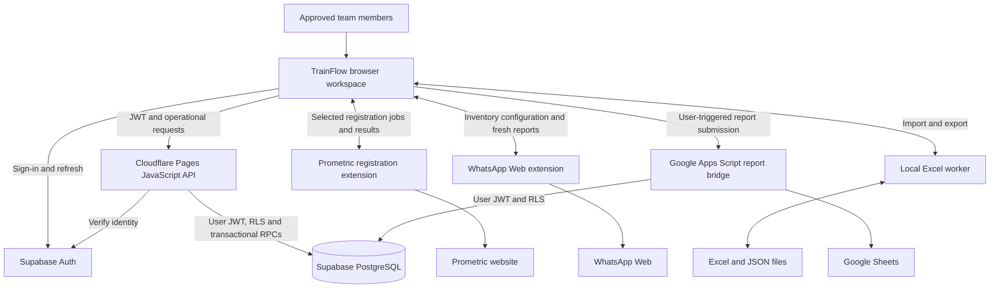
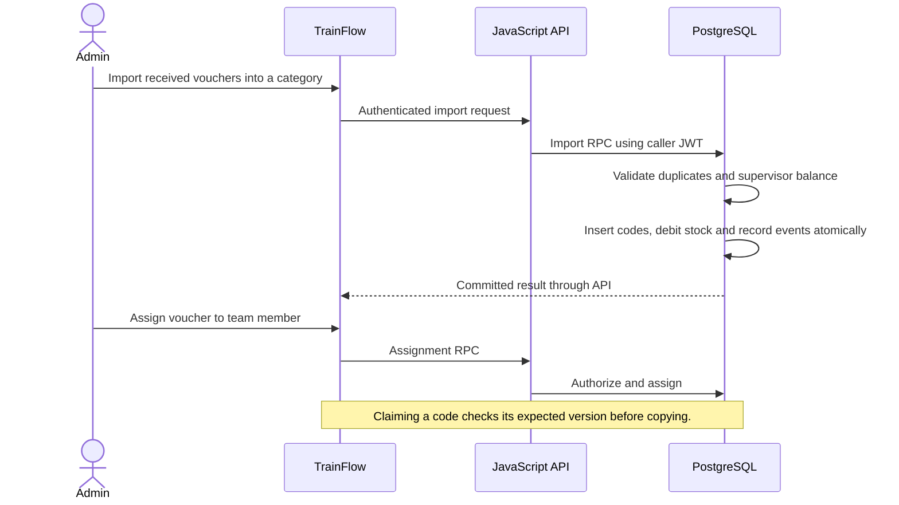
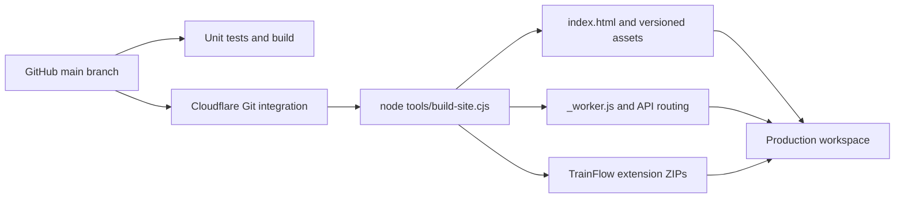

# TrainFlow architecture

TrainFlow manages the work between receiving exam vouchers, assigning them to a team member, preparing trainees, registering Prometric accounts and reporting results. This document describes the implemented system, rather than a proposed redesign.

## System overview

The browser is the working surface. The server checks operational requests, while PostgreSQL policies and functions enforce ownership and atomic updates. Extensions execute only the external website actions that need a logged-in browser.

## Repository map

| Path | Responsibility |
| --- | --- |
| `trainflow.html` | Local application entry point, layout, shared styles and Arabic/English interface strings |
| `cloud.js` | Authentication, same-origin data adapter, codes, stock, membership, backups and trainee persistence |
| `ops-ui.js` | Administrative import, restore and settings interactions |
| `trainees.js`, `trainees.css` | Private trainee workspace and virtualized grid rendering |
| `trainees-core.js` | Trainee values, validation and matching logic |
| `trainees-excel.js` | Selection, formatting, formulas and spreadsheet commands |
| `trainees-xlsx.js`, `trainees-xlsx-worker.js`, `trainees-files.js` | Local Excel import/export and file previews |
| `certificate-name.js` | Certificate name correction preview and export |
| `prometric-core.js`, `prometric-registration.js` | Registration eligibility, job preview and extension coordination |
| `inventory-delivery.js` | Inventory reporting and scheduled delivery controls |
| `trainee-reports.js` | Daily report preparation and Google report submission |
| `session-policy.js` | Shared daily sign-in policy used by browser and API |
| `server/worker.mjs` | Production JavaScript API running on Cloudflare Pages |
| `extension/prometric/` | Manifest V3 registration extension and TrainFlow page bridge |
| `extension/whatsapp-web/` | Manifest V3 schedule, inventory bridge and WhatsApp sender |
| `tools/build-site.cjs` | Production assets, worker, asset hashes and extension ZIP packages |
| `tools/design-preview.cjs` | UI preview with synthetic data; no production writes |
| `tools/google-reports.gs` | Google Apps Script bridge for existing report spreadsheets |
| `database.sql`, `migrations/`, `supabase/migrations/` | Original schema and incremental database changes |
| `tests/`, `database-tests.sql` | Unit, API, browser and SQL regression checks |
| `docs/` | Operations, deployment and integration documentation |
| `.github/workflows/ci.yml` | Automated unit checks and production build |
| `dist/` | Generated deployment output; ignored by Git |

## Data ownership

The existing database keeps its stable `ibta_*` object names. TrainFlow is the product name; these identifiers are a compatibility contract with deployed database functions and integrations.

| Table | Purpose and ownership |
| --- | --- |
| `ibta_members` | Approved accounts, active state and `admin`, `operator` or `copy_only` role |
| `ibta_settings` | Shared exam catalog, category labels, service connection details and configuration |
| `ibta_codes` | Unique vouchers, owner, usage timestamp, notes and optimistic version |
| `ibta_trainee_sheets` | Owner-specific trainee cells, formatting and save version |
| `ibta_supervisor_stock` | Unallocated supervisor stock per category |
| `ibta_supervisor_stock_events` | Stock adjustments and allocations |
| `ibta_audit` | Database-generated action, actor and timestamp records |
| `private.ibta_inventory_delivery` | Delivery configuration exposed through authorized RPCs |
| `private.ibta_inventory_delivery_log` | Server delivery history, separate from browser extension state |

Additional delivery objects are defined in the inventory migrations. Read their policies and functions before extending delivery behavior. Auth accounts are managed separately from application backups.

## Main workflows

### Allocate and claim a voucher

Concurrent requests use server-side checks and optimistic versions. A clipboard failure retains the reservation for the same user, so they can retry or release it. Import, allocation and restore are database transactions.

### Edit a trainee sheet

The browser loads the selected owner's sheet and version. Editing, sorting, formatting and Undo/Redo operate locally. Save submits cells and format with the expected version; a conflicting save is rejected. Virtual rendering draws the visible part of the sheet. Blank trailing rows do not expand the persisted matrix until populated.

### Register Prometric accounts

The application previews selected trainees, validates required values and skips existing credentials. The extension receives only selected names, emails and matching metadata, then processes registration jobs sequentially in a dedicated tab. Confirmed results fill blank matching credential cells. Pending results survive in extension storage until the application acknowledges a successful sheet save. Uncertain outcomes require checking Prometric before retrying.

### Send an inventory report

The administrator configures a destination and Riyadh send time. The extension prepares a fresh report before sending, validates the destination and message and records the outcome. The computer, Chrome, WhatsApp Web and a valid application session must be available. Enable automatic sending on one device. The separate manual WhatsApp link opens a draft that a person sends themselves.

### Exchange files and daily reports

Excel conversion uses a local Web Worker and bundled ExcelJS. JSON application backups use `trainflow-backup` and version 4; the restore path also accepts `ibta-ops-backup`. Google report submission uses the Apps Script bridge, reads authorized source data and appends matching report columns with voucher-based deduplication.

## API and trust boundaries

| Route | Behavior |
| --- | --- |
| `GET /api/health` | Public runtime status including the TrainFlow application name |
| `/api/data/<table>` | Allowlisted table operations with membership checks |
| `POST /api/data/rpc/<function>` | Allowlisted transactional operations; administrative functions require an administrator |

The worker rejects foreign origins, missing/invalid tokens, inactive memberships, disallowed routes, unsuitable methods and malformed/oversized JSON. It forwards the caller's JWT rather than using a service-role key. Operational responses use `Cache-Control: no-store`.

Supabase REST remains reachable by authenticated clients, including the report bridge. Database RLS remains necessary even with the worker. Display names in Auth metadata do not grant privileges. Extension bridges validate the page origin, message source and channel.

Only device preferences remain in browser local storage. Authentication uses session storage and daily sign-in rules. Registration results and scheduled delivery state also have extension-local storage. Operational records are persisted in PostgreSQL.

## Build and deployment

The source entry point becomes `dist/index.html`. The build adds content hashes to browser assets and creates `trainflow-prometric.zip` and `trainflow-whatsapp-web.zip`. Legacy ZIP names remain available so older installed pages can still download updates. SQL, tests, backups and documentation are excluded from deployment.

Cloudflare's project display name is `trainflow`. Its existing `ibta-ops.pages.dev` hostname remains stable: Cloudflare's rename dialog explicitly states that renaming does not change hostnames or deployments. Keeping that origin preserves Auth redirects and installed extension origin checks.

## Compatibility decisions

| Identifier | Reason it remains stable |
| --- | --- |
| Supabase project reference and API URL | Existing database and users stay attached to the same project |
| `ibta_*` tables/RPCs and SQL history | Existing schema, policies and deployed integrations depend on them |
| `IBTA_*` extension channels and internal error codes | Older extensions and server errors remain compatible |
| Existing storage keys | Saved preferences, pending jobs and extension state remain readable |
| `IBTAMEAF-…` voucher examples | Actual exam provider format, separate from product branding |
| `ibta-ops-backup` | Older backups remain restorable |

Rename these contracts only through a separately planned migration that updates all producers, consumers and stored data together.

## Verification and recovery

Run `pnpm test`, `pnpm test:browser` and `pnpm build` before publishing changes to runtime behavior. Browser suites require Microsoft Edge; SQL suites need a separately authenticated test database and are not part of JavaScript CI. A UI preview uses synthetic data and does not prove live sign-in or database writes.

For a faulty frontend deployment, roll back through Cloudflare Pages or revert the Git commit and let the integration redeploy. Database migrations require their own recovery plan; a frontend rollback does not reverse schema changes. Application JSON exports supplement database backups and contain sensitive operational data, including configured credentials.

## Further reading

- [Operations guide](docs/operations-guide.md)
- [Deployment and maintenance](docs/deployment.md)
- [JavaScript API details](docs/javascript-server.md)
- [WhatsApp Web setup](docs/whatsapp-web.md)
- [Google reports setup](docs/google-reports.md)
- [Documentation index](docs/README.md)
