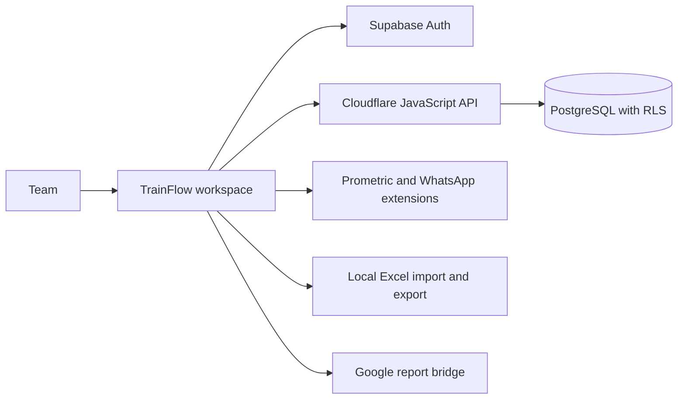

# TrainFlow

**Training & Exam Operations**

TrainFlow connects trainee records, exam vouchers, supervisor stock, Prometric registration and team reporting in one Arabic/English workspace.

## Next.js with the original interface

The application keeps Next.js and TypeScript while displaying the original TrainFlow interface: the top tabs, Excel-style trainee sheet, dialogs, formatting controls and existing settings. `app/layout.tsx` mounts `components/ClassicWorkspace.tsx` directly in the page, without an iframe or a redesigned sidebar. The original command modules remain responsible for their existing document IDs, extension messages and sheet operations.

`pnpm build` first packages the existing interface and its assets into `public/workspace`, generates a TypeScript interface manifest, then builds Next.js with type checking. `pnpm dev` performs the same preparation before starting development. `pnpm test:next` verifies the production Next.js interface against the original preview; run it after building.

The existing Supabase project, `ibta_*` tables, account permissions and versioned trainee sheets stay in use. The TypeScript `/api/data/[...path]` route calls the original validated API handler with the user's JWT. This interface change performs no database migration or record conversion. Vercel uses the Next.js configuration in `vercel.json`; the existing Cloudflare build remains available through `pnpm build:cloudflare`.

[Open TrainFlow](https://ibta-ops.pages.dev/) · [Architecture](ARCHITECTURE.md) · [Documentation](docs/README.md) · [Deployment](docs/deployment.md)

## What the system does

- Manages approved team accounts and administrator/operator/copy-only roles.
- Imports, allocates and atomically claims exam vouchers with stock tracking.
- Provides private trainee sheets with Excel-style editing, formatting, search and local Excel exchange.
- Registers selected trainees through the connected Prometric extension and recovers confirmed results.
- Prepares inventory reports and supports scheduled WhatsApp Web delivery.
- Prepares daily Google reports and certificate name correction exports.
- Records audit activity and exports/restores private operational backups.

## Architecture at a glance



See [ARCHITECTURE.md](ARCHITECTURE.md) for component ownership, data models, workflow diagrams, trust boundaries and deployment details.

## Run and verify

Requires Node.js 20+ and pnpm. Browser tests require Microsoft Edge.

```sh
pnpm install --frozen-lockfile
pnpm test
pnpm test:browser
pnpm build
```

For a local interface preview with synthetic data, run `node tools/design-preview.cjs` and open `http://127.0.0.1:4174`. The application entry file is `trainflow.html`; production API calls need a Cloudflare runtime rather than a plain file/static server.

## Project layout

| Area | Location |
| --- | --- |
| Browser interface and feature modules | `trainflow.html`, root JavaScript and CSS files |
| JavaScript API | `server/` |
| Browser extensions | `extension/prometric/`, `extension/whatsapp-web/` |
| Database schema and migrations | `database.sql`, `migrations/`, `supabase/migrations/` |
| Build and report tools | `tools/` |
| Automated checks | `tests/`, `.github/workflows/` |
| Architecture and guides | `ARCHITECTURE.md`, `docs/` |
| Generated website | `dist/` (ignored) |

## Production and compatibility

GitHub repository: [salahmostava-sys/trainflow](https://github.com/salahmostava-sys/trainflow). Cloudflare project: `trainflow`. Production branch: `main`. Build: `node tools/build-site.cjs`; output: `dist`.

The established production address remains [ibta-ops.pages.dev](https://ibta-ops.pages.dev/). Renaming the Cloudflare project preserves its hostname and deployed data connections. Database object names, stored preference keys and extension protocol channels also remain stable for compatibility; they are documented in [the architecture](ARCHITECTURE.md#compatibility-decisions).

Current backup exports use `trainflow-backup`, and existing `ibta-ops-backup` files remain supported. The `IBTAMEAF` example is an exam-provider voucher format.

## Guides

- [Operations and account setup](docs/operations-guide.md)
- [Build, deployment and rollback](docs/deployment.md)
- [JavaScript API](docs/javascript-server.md)
- [Prometric extension](extension/prometric/README.md)
- [WhatsApp Web delivery](docs/whatsapp-web.md)
- [Google reports](docs/google-reports.md)
